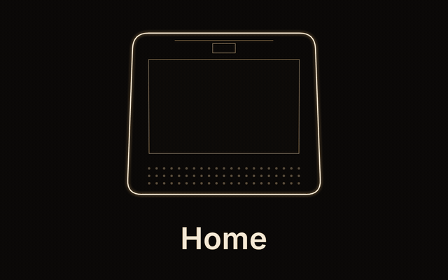
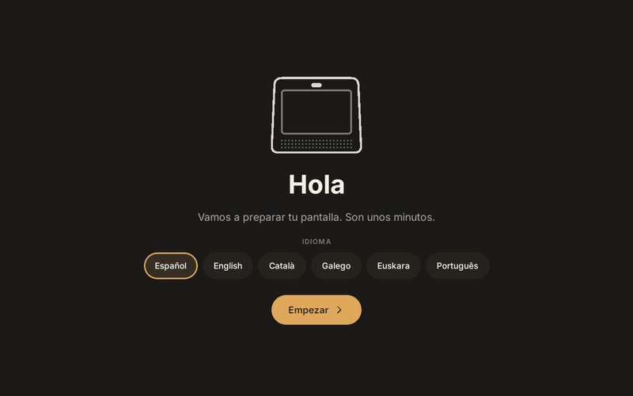
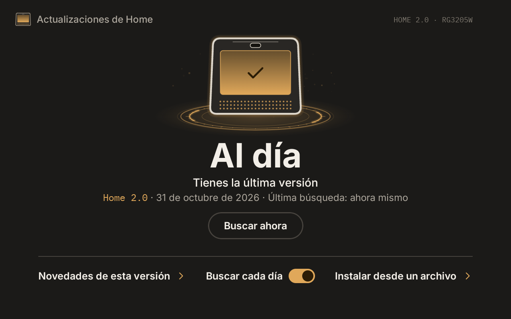
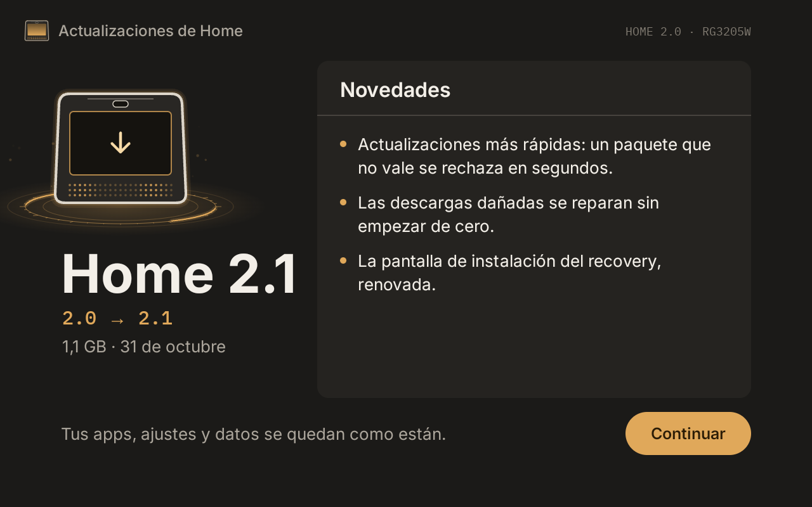
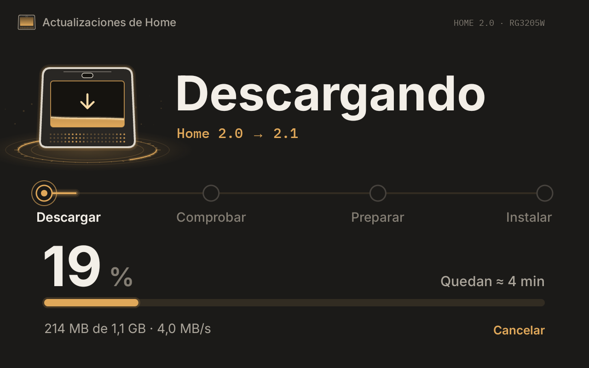
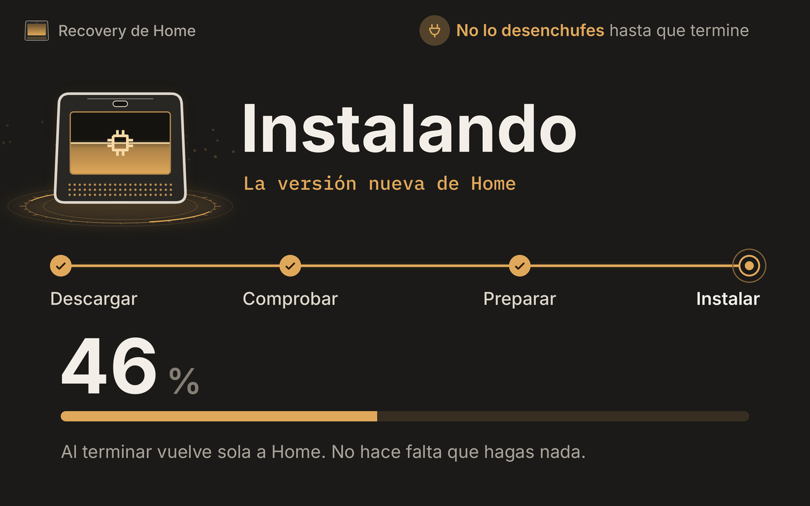

  

  <b>Android 15 for the Askey RG3205W</b> 
  Built for this device. Clean, encrypted and ready in a few minutes.

  
  
  
  
  

  <a href="https://daniel1286.github.io/home-rom-rg3205w/"><b>Try the demo</b></a>
  &nbsp;·&nbsp;
  <a href="#whats-inside"><b>What's inside</b></a>
  &nbsp;·&nbsp;
  <a href="guias/INSTALL.md"><b>Installation guide</b></a>
  &nbsp;·&nbsp;
  <a href="#technical-details"><b>Technical details</b></a>
  &nbsp;·&nbsp;
  <a href="README.md"><b>Español</b></a>

 

> [!NOTE]
> **2.0 is out.** Download it from **[Releases](https://github.com/daniel1286/home-rom-rg3205w/releases/latest)** and follow the [install guide](guias/INSTALL.md). To hear about new versions, click **Watch → Custom → Releases** at the top right.

## What is Home

The Askey RG3205W is an 8-inch screen with speakers and microphones that ships with Android 8.1 and the carrier's software. Home replaces it with Android 15.

It isn't a ROM from some other phone squeezed onto this one: it's built from LineageOS source for this device only, with its own kernel and drivers. It comes clean, with no carrier apps, and the first time you turn it on a setup wizard gets it ready in a few minutes, as a Home Assistant panel, as a speaker for your home or as a regular tablet.

The setup wizard speaks Spanish, English, Catalan, Galician, Basque and Portuguese. The screenshots below are in Spanish.

## What's inside

<table>
  <tr>
    <td width="50%" valign="top">
      <h3>Real Android 15</h3>
      Built for this device and in landscape, like an 8-inch tablet. Wi-Fi, Bluetooth, speakers, microphones and camera all work.
    </td>
    <td width="50%" valign="top">
      <h3>Ready in minutes</h3>
      A setup wizard on first boot that only asks what it needs. In Spanish, English, Catalan, Galician, Basque and Portuguese.
    </td>
  </tr>
  <tr>
    <td valign="top">
      <h3>Home Assistant panel</h3>
      If you pick it, it installs Fully Kiosk from its official website and opens your dashboard full screen every time it starts.
    </td>
    <td valign="top">
      <h3>A speaker for your home</h3>
      With Snapcast it plays in sync with the rest of your speakers. And with droidVNC-NG you can control it from your PC. Both are optional.
    </td>
  </tr>
  <tr>
    <td valign="top">
      <h3>Your apps, no Google account</h3>
      Aurora Store for Google Play apps and F-Droid for free software. The apps it comes with update from there like any other.
    </td>
    <td valign="top">
      <h3>Updates itself</h3>
      When I publish a new version here, the Updates app lets you know and you choose when to install it. It keeps your data and apps, picks up where it left off if Wi-Fi drops, and only accepts updates signed by me.
    </td>
  </tr>
  <tr>
    <td valign="top">
      <h3>Your data, encrypted</h3>
      If someone takes the device, they can't read what's stored on it. SELinux is enforcing and it has the October 2026 security patch.
    </td>
    <td valign="top">
      <h3>Nothing watching you</h3>
      No carrier apps and no telemetry. The only thing it checks on its own is GitHub, to look for updates. And Magisk root for whoever wants it.
    </td>
  </tr>
</table>

## Screenshots

### Boot

First the splash screen, and then, while Android loads, the boot animation you see at the top.

  

### Setup wizard

Language, time zone, Wi-Fi, device name, which apps you want, display and privacy. The Home Assistant and speaker steps only show up if you choose them.

  
    
  
   
  It opens the full boot and setup wizard: tap the screen as if it were the device.

<table>
  <tr>
    <td width="33%"></td>
    <td width="33%"></td>
    <td width="33%"></td>
  </tr>
  <tr>
    <td align="center">Welcome and language</td>
    <td align="center">Region and time</td>
    <td align="center">Choosing apps</td>
  </tr>
  <tr>
    <td></td>
    <td></td>
    <td></td>
  </tr>
  <tr>
    <td align="center">Home Assistant panel</td>
    <td align="center">Home speaker</td>
    <td align="center">Summary before applying</td>
  </tr>
</table>

### Updates

The Updates app checks this repository's releases for a new version, shows you what's in it and downloads it whenever you want. Before downloading all of it, it checks the signature, that it is newer and the size, and turns down anything that doesn't match. To install it, the device restarts into TWRP, which shows the progress, and comes back to Home on its own.

<table>
  <tr>
    <td width="50%"></td>
    <td width="50%"></td>
  </tr>
  <tr>
    <td align="center">Up to date</td>
    <td align="center">A new version, with what's new</td>
  </tr>
  <tr>
    <td width="50%"></td>
    <td width="50%"></td>
  </tr>
  <tr>
    <td align="center">Downloading, with time left</td>
    <td align="center">TWRP installing it</td>
  </tr>
</table>

### Wallpapers

<table>
  <tr>
    <td width="25%"></td>
    <td width="25%"></td>
    <td width="25%"></td>
    <td width="25%"></td>
  </tr>
  <tr>
    <td align="center">Plataforma (default)</td>
    <td align="center">Rejilla</td>
    <td align="center">Polvo de luz</td>
    <td align="center">Claro</td>
  </tr>
</table>

## Technical details

For anyone who wants to know what's under the hood.

<b>Hardware and how Home uses it</b>

 

| Component | Hardware | In Home |
|---|---|---|
| System | — | LineageOS 22.2 (Android 15) built from source, with its own device tree. Fully 64-bit; only the camera keeps 32-bit libraries |
| CPU | Snapdragon 625 (APQ8053), 8 × Cortex-A53 | Kernel 4.9 based on Qualcomm's source (CodeLinaro), up to date with Linux 4.9 stable |
| GPU | Adreno 506 | Qualcomm drivers and the CAF graphics HAL built from source. OpenGL ES 3.2 and Vulkan 1.1 |
| Display | 8", 1280 × 800, HX8394-D panel | Manufacturer panel timings in the device tree |
| Touch | Goodix GT9xx | Kernel driver adapted to the RG3205W pinout |
| Audio | WCD9335 codec, 2 speakers and 4 microphones | Qualcomm audio HAL built from source, with the manufacturer's calibration |
| Wi-Fi | QCA9379, 2.4 and 5 GHz | qcacld-2.0 built from source |
| Bluetooth | QCA9379 over UART | Linux driver (hci_qca) in the kernel and the AOSP Bluetooth HAL |
| Camera | OV2735 | Camera HAL built from source; the manufacturer's imaging service is the only 32-bit part |
| Brightness | Panel backlight | Own lights HAL |
| Power | Always plugged in, no battery | Own HAL: Android knows there's no battery and never warns about low battery |
| Temperature | CPU sensors | Own thermal HAL |
| Clock | No RTC battery | Own service that keeps the time across reboots |
| Protected content | — | Widevine L3 |

<b>Security and updates</b>

 

| | In Home |
|---|---|
| Build | `user`, the production build. Signed with my own keys, which are never published |
| SELinux | Enforcing, with rules written for this hardware |
| Security patch | October 2026 |
| Data | File-based encryption (FBE) |
| Updates | Its own app, Updates, which checks this repository's releases. It only installs packages signed by me and newer than the installed one; TWRP installs them without wiping data. It also opens from Settings |
| Root | Magisk is in the boot image, but root is off by default. You turn it on in the setup wizard, under “Advanced options” |
| Recovery | TWRP with the Home design, with its own screen for installing updates |
| Debugging | ADB off by default |

## What you'll need

- An Askey RG3205W, Rev4 or Rev5.
- A PC running 64-bit Windows 10 or 11.
- A USB cable to connect it to the PC. The Rev5 also needs an adapter for the internal J4902 connector ([how to tell which one you have](guias/INSTALL.md#2-rev4-or-rev5-and-connecting-it-to-the-pc)).

## Installation

The **[installation guide](guias/INSTALL.md)** walks through everything step by step, with drawings, for people who have never installed a ROM. In short:

1. Open the device to see whether it's a Rev4 or a Rev5, and connect it to the PC.
2. Install Google's USB drivers on Windows.
3. Get into fastboot mode with the buttons and unlock the bootloader if needed.
4. Run the installer that comes in the zip.
5. Reboot and follow the setup wizard.

> [!WARNING]
> Installing it wipes all data on the device. Modifying the software may void your warranty, so do it at your own risk.

## Already installed it?

Tell me how it went in a **[test report](https://github.com/daniel1286/home-rom-rg3205w/issues/new?template=informe_prueba.yml)**. It takes two minutes: your revision (Rev4 or Rev5), the Home version you installed, and what works and what doesn't. Every report tells me which devices Home runs well on and what I need to improve.

For questions, bugs or ideas, open an issue in **[Issues](https://github.com/daniel1286/home-rom-rg3205w/issues)**.

## Source code

Each release includes the kernel source (`Home-<version>-kernel-src.tar.gz`) and the recovery source (`Home-<version>-twrp-src.tar.gz`) that version was built from.

## Credits

Home wouldn't exist without the work of a lot of people:

- [LineageOS](https://lineageos.org), the base of the system.
- [Qualcomm CodeLinaro](https://git.codelinaro.org/clo/la) and [Linux](https://kernel.org), where the kernel comes from.
- [xiaomi-msm8953-devs](https://github.com/xiaomi-msm8953-devs/android_kernel_xiaomi_msm8953), which I used as a reference for the msm8953 kernel.
- [zry98/movistar-home-hacks](https://github.com/zry98/movistar-home-hacks), for documenting the hardware, the unlock and EDL mode.
- [TWRP](https://twrp.me), [Magisk](https://github.com/topjohnwu/Magisk), [Aurora Store](https://gitlab.com/AuroraOSS/AuroraStore), [F-Droid](https://f-droid.org), [Snapcast](https://github.com/badaix/snapdroid) and [droidVNC-NG](https://github.com/bk138/droidVNC-NG).

## License

Home's own code is released under the [Apache License 2.0](LICENSE). The kernel is GPL-2.0, like Linux, and TWRP and third-party apps keep their own licenses.

 

  Home is an independent project, not affiliated with Askey or any carrier. All trademarks belong to their respective owners.

