<p align="right"><a href="INSTALL.md">English</a> · <a href="../README.md">Volver al inicio</a></p>

# Guía de instalación

Esta guía explica cómo instalar Home en un Askey RG3205W desde un PC con Windows. Está pensada para seguirla de principio a fin aunque nunca hayas instalado una ROM: cada paso dice qué hacer, qué vas a ver y qué hacer si algo no sale. Calcula entre 30 y 45 minutos la primera vez.

> [!NOTE]
> Home todavía no está publicado. Los pasos 1 a 5 (abrirlo, conectarlo, drivers y desbloqueo) no dependen de la versión, así que puedes dejarlos hechos ya.

> [!WARNING]
> La instalación **borra todos los datos** del aparato. Abrirlo y cambiarle el software puede anular la garantía y no está cubierto por el contrato con tu operador. Sigue la guía bajo tu responsabilidad.

<p align="center">
  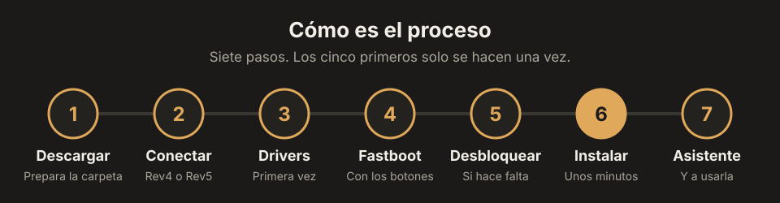
</p>

## Contenido

1. [Qué necesitas](#1-qué-necesitas)
2. [Saber si es Rev4 o Rev5 y conectarlo al PC](#2-saber-si-es-rev4-o-rev5-y-conectarlo-al-pc)
3. [Instalar los drivers USB](#3-instalar-los-drivers-usb)
4. [Entrar en modo fastboot](#4-entrar-en-modo-fastboot)
5. [Desbloquear el bootloader](#5-desbloquear-el-bootloader)
6. [Instalar Home](#6-instalar-home)
7. [Primer arranque](#7-primer-arranque)
8. [Asistente de configuración](#8-asistente-de-configuración)
9. [Actualizaciones, ADB y root](#9-actualizaciones-adb-y-root)
10. [Si algo va mal](#10-si-algo-va-mal)
11. [Copia de seguridad y rescate por EDL](#11-copia-de-seguridad-y-rescate-por-edl)

---

## 1. Qué necesitas

| | Dónde conseguirlo |
| --- | --- |
| Askey RG3205W, Rev4 o Rev5 | — |
| PC con Windows 10 u 11 de 64 bits | — |
| Cable USB adecuado a tu revisión | [Paso 2](#2-saber-si-es-rev4-o-rev5-y-conectarlo-al-pc) |
| Home | [Releases](../../../releases/latest) de este repositorio, archivo `Home-<versión>-RG3205W.zip` |
| SDK Platform-Tools (`adb` y `fastboot`) | [developer.android.com/tools/releases/platform-tools](https://developer.android.com/tools/releases/platform-tools) |
| Google USB Driver | [developer.android.com/studio/run/win-usb](https://developer.android.com/studio/run/win-usb) |

Crea una carpeta de trabajo, por ejemplo `C:\Home`, y descomprime dentro el zip de Home y el de Platform-Tools. Tiene que quedar así:

```
C:\Home\
├── boot.img        + boot.img.sha256
├── recovery.img    + recovery.img.sha256
├── system.img      + system.img.sha256
├── vendor.img      + vendor.img.sha256
├── splash.img      + splash.img.sha256
├── instalar_home.ps1
├── LEEME.txt
└── platform-tools\
    ├── adb.exe
    └── fastboot.exe
```

Todos los comandos de esta guía se escriben en PowerShell desde esa carpeta. Para abrirlo ahí: entra en `C:\Home` con el Explorador, haz clic en la barra de direcciones, escribe `powershell` y pulsa Intro.

> [!TIP]
> Si te animas, antes de instalar haz una copia completa del aparato por EDL ([sección 11](#11-copia-de-seguridad-y-rescate-por-edl)). Con ella siempre podrás volver a dejarlo como estaba.

## 2. Saber si es Rev4 o Rev5 y conectarlo al PC

Hay dos revisiones de la placa y cada una se conecta al PC de una forma. La fecha de la etiqueta no sirve para saber cuál tienes: hay que quitar la tapa trasera.

**Cómo abrirlo:**

1. Suelta las 10 pestañas de plástico de los bordes de la tapa trasera.
2. Quita los 8 tornillos que hay debajo de la tapa.
3. Quita los 4 tornillos escondidos bajo la tira de goma negra de la parte de abajo.

Con la tapa quitada, mira la esquina de la placa marcada en rojo en las fotos y la serigrafía de abajo a la derecha, donde pone **Rev4** o **Rev5**:

<table>
  <tr>
    <td width="50%"></td>
    <td width="50%"></td>
  </tr>
  <tr>
    <td align="center"><b>Rev4</b>: tiene un USB-C soldado (arriba a la derecha)</td>
    <td align="center"><b>Rev5</b>: ese hueco está vacío</td>
  </tr>
</table>
<p align="center"><sub>Fotos de <a href="https://github.com/zry98/movistar-home-hacks/tree/main/RG3205W">zry98/movistar-home-hacks</a> (GPL-3.0)</sub></p>

| Revisión | Cómo reconocerla | Conexión al PC |
| --- | --- | --- |
| **Rev4** | Tiene un conector USB-C soldado en la placa | Cable USB-C normal, sin más |
| **Rev5** | No tiene USB-C (es la más habitual) | Conector interno **J4902**: hace falta un cable como el de abajo |

### El cable para el Rev5

El **J4902** es el conector blanco de 4 pines (JST-PH 2.0) que hay cerca del hueco del USB-C. Lleva las cuatro líneas del USB, así que basta con unirlo a un cable USB normal. Estos son sus pines, de izquierda a derecha:

<p align="center">
  
  <br>
  <sub>Foto de <a href="https://github.com/zry98/movistar-home-hacks/tree/main/RG3205W">zry98/movistar-home-hacks</a> (GPL-3.0)</sub>
</p>

<p align="center">
  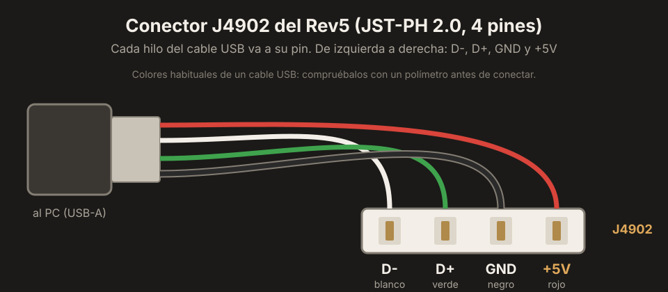
</p>

Cómo hacerlo:

1. Coge un cable USB que no uses y córtalo, quedándote con el lado de la clavija USB-A (la que va al PC).
2. Pela los cuatro hilos de dentro. Lo normal es que sean rojo, blanco, verde y negro.
3. Une cada hilo a su pin con un conector **JST-PH 2.0 macho de 4 pines** o, si no tienes, con cuatro terminales hembra de paso 2,0 mm:

   | Pin del J4902 | Hilo del cable USB |
   | --- | --- |
   | D- (el de la izquierda) | Blanco |
   | D+ | Verde |
   | GND | Negro |
   | +5V (el de la derecha) | Rojo |

4. Antes de conectarlo a la placa, comprueba con un polímetro que cada pin llega al contacto correcto de la clavija USB.
5. Enchúfalo en el J4902 con la misma orientación que en la foto.

> [!CAUTION]
> Los colores son los estándar de USB, pero no todos los cables los respetan. Compruébalo siempre con el polímetro: si cruzas +5V y GND puedes estropear la placa.

Toda esta información del hardware sale del trabajo de [zry98/movistar-home-hacks](https://github.com/zry98/movistar-home-hacks/tree/main/RG3205W).

## 3. Instalar los drivers USB

Windows necesita el **Google USB Driver** para hablar con el aparato en modo fastboot. Solo se hace una vez.

<p align="center">
  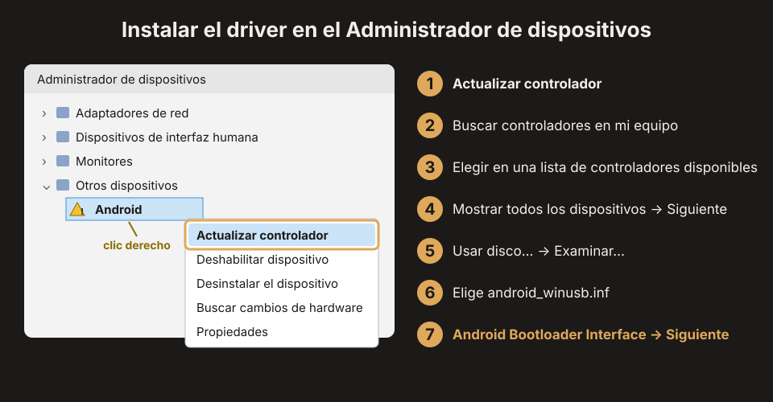
</p>

1. Descomprime el Google USB Driver. Tendrás una carpeta `usb_driver` con el archivo `android_winusb.inf`.
2. Pon el aparato en modo fastboot ([paso 4](#4-entrar-en-modo-fastboot)) y conéctalo al PC.
3. Abre el **Administrador de dispositivos**: tecla Windows + X → Administrador de dispositivos.
4. En **Otros dispositivos** verás uno con un triángulo amarillo, normalmente llamado «Android».
5. Clic derecho sobre él → **Actualizar controlador** → **Buscar controladores en mi equipo** → **Elegir en una lista de controladores disponibles en el equipo**.
6. Si te pregunta el tipo de dispositivo, elige **Mostrar todos los dispositivos** y pulsa **Siguiente**.
7. Pulsa **Usar disco…** → **Examinar…** y elige `android_winusb.inf`.
8. Selecciona **Android Bootloader Interface**, pulsa **Siguiente** y acepta el aviso de Windows si sale.
9. Comprueba que el PC lo ve:

   ```powershell
   .\platform-tools\fastboot.exe devices
   ```

   Tiene que salir un número de serie seguido de `fastboot`. Si no sale nada, mira la [sección 10](#10-si-algo-va-mal).

> [!TIP]
> Para usar ADB por cable con Android encendido se usa el mismo driver: repite el proceso y elige **Android Composite ADB Interface**.

| Modo | VID:PID | Driver |
| --- | --- | --- |
| Fastboot | `18D1:D00D` | Android Bootloader Interface |
| ADB | `18D1:4EE7` | Android Composite ADB Interface |
| EDL | `05C6:9008` | WinUSB con Zadig ([sección 11](#11-copia-de-seguridad-y-rescate-por-edl)) |

## 4. Entrar en modo fastboot

El modo fastboot es el que permite instalar el sistema. Con el software de Movistar se llega desde su menú de recuperación (recovery), que **no sale solo**: hay que hacer dos combinaciones de botones seguidas.

> [!IMPORTANT]
> Conecta el USB al PC **después** de entrar en fastboot. Si el aparato arranca con el USB del PC conectado, puede quedarse en modo carga.

**Primera combinación: entrar en el recovery**

<p align="center">
  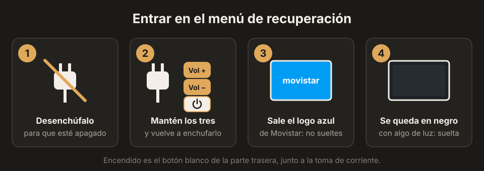
</p>

1. Desenchufa el aparato para que esté apagado.
2. Mantén pulsados **Vol +** y **Vol −** (arriba) y **Encendido** (el botón blanco de atrás, junto a la toma de corriente), y sin soltarlos vuelve a enchufarlo.
3. Sale la pantalla azul con el logo blanco de Movistar. **No sueltes todavía.**
4. Cuando el logo desaparezca y la pantalla se quede en negro (pero con algo de luz), **suelta los tres botones enseguida**.

**Segunda combinación: abrir el menú y elegir fastboot**

<p align="center">
  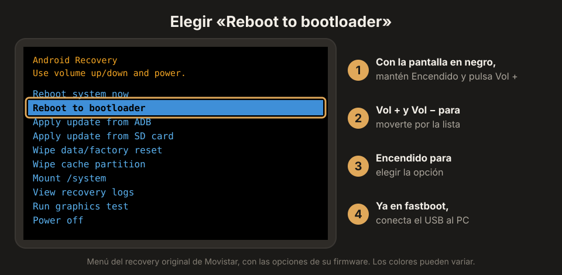
</p>

5. Con la pantalla en negro, mantén pulsado **Encendido** y pulsa **Vol +** una vez: aparece el menú.
6. Muévete con **Vol +** y **Vol −** hasta **Reboot to bootloader** y elígelo con **Encendido**.
7. Cuando esté en fastboot, conecta el USB al PC.

> [!TIP]
> Si el menú no sale, vuelve a empezar desde el punto 1: lo más habitual es soltar los botones demasiado pronto o demasiado tarde. Si con la carcasa puesta no los pulsas bien, con la tapa quitada se pulsan directamente.

**Si ya tienes Home instalado** (por ejemplo, para reinstalar), es más fácil: desde el recovery de Home (TWRP), **Reiniciar → Bootloader** entra en fastboot. Con ADB activado también vale:

```powershell
.\platform-tools\adb.exe reboot bootloader
```

## 5. Desbloquear el bootloader

Mira cómo está el bootloader:

```powershell
.\platform-tools\fastboot.exe getvar unlocked
```

Si responde `unlocked: yes`, ve directamente al [paso 6](#6-instalar-home). Si responde `no`, desbloquéalo:

```powershell
.\platform-tools\fastboot.exe flashing unlock
.\platform-tools\fastboot.exe oem unlock
```

Si el aparato pide confirmación en pantalla, acéptala con los botones de volumen y encendido. Después vuelve a comprobarlo con `getvar unlocked`.

> [!CAUTION]
> No vuelvas a bloquear el bootloader (`fastboot flashing lock` u `oem lock`) con Home instalado: el aparato podría dejar de arrancar.

## 6. Instalar Home

El paquete trae un instalador que lo hace todo por ti y comprueba cada imagen antes de escribirla.

Windows bloquea los scripts descargados de internet. La primera vez, desbloquéalo:

```powershell
Unblock-File .\instalar_home.ps1
```

Haz primero una **simulación**. No escribe nada: comprueba que las imágenes están bien y te enseña lo que va a hacer.

```powershell
powershell -ExecutionPolicy Bypass -File .\instalar_home.ps1 -Accion Instalar
```

Si todas las imágenes salen como `ok`, lanza la instalación de verdad:

```powershell
powershell -ExecutionPolicy Bypass -File .\instalar_home.ps1 -Accion Instalar -DeVerdad
```

El instalador comprueba que es un RG3205W con el bootloader desbloqueado y te pide confirmación: escribe `SI` y pulsa Intro. Tarda unos minutos.

```
== Fastboot
  > fastboot flash boot ...       OKAY
  > fastboot flash recovery ...   OKAY
  > fastboot flash vendor ...     OKAY
  > fastboot flash system ...     OKAY
  > fastboot flash splash ...     OKAY
  > fastboot format cache         OKAY
  > fastboot format userdata      OKAY
== Hecho
```

> [!NOTE]
> El mensaje `Invalid sparse file format at header magic` es normal: fastboot parte `system.img` en trozos para enviarla.

El instalador solo escribe en `boot`, `recovery`, `vendor`, `system` y `splash`, y formatea `cache` y `userdata`. No toca las particiones con datos propios de tu aparato (`persist`, `modem`, calibraciones). El recovery se instala siempre porque es el que aplica las actualizaciones.

## 7. Primer arranque

1. Desconecta el USB del PC.
2. Desenchufa el aparato y vuelve a enchufarlo.

Sale el splash de Home y después la animación de arranque. La primera vez tarda varios minutos, porque Android prepara las aplicaciones y cifra los datos; mientras tanto la animación se repite. Es normal.

<table>
  <tr>
    <td>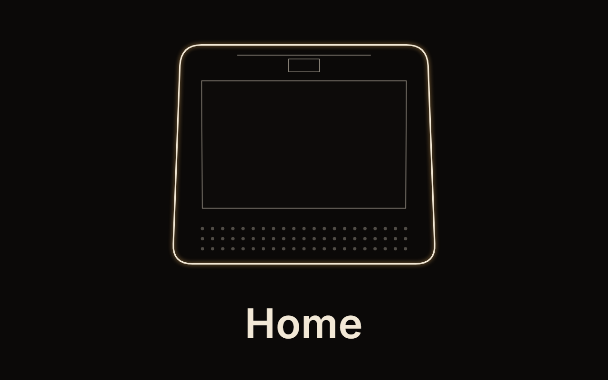</td>
    <td>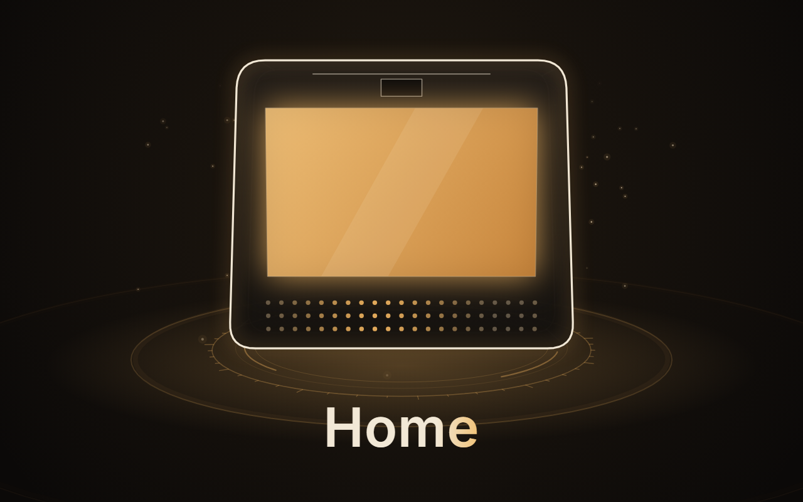</td>
  </tr>
  <tr>
    <td align="center"><sub>Splash</sub></td>
    <td align="center"><sub>Animación de arranque</sub></td>
  </tr>
</table>

## 8. Asistente de configuración

Al terminar de arrancar se abre el asistente. En todos los pasos tienes **Atrás** abajo a la izquierda y **Siguiente** abajo a la derecha.

> [!TIP]
> Puedes probar el asistente en el navegador antes de instalar nada: [abre la demo](https://daniel1286.github.io/home-rom-rg3205w/).

**Bienvenida.** Elige el idioma: el asistente cambia al momento y el sistema queda en ese idioma.

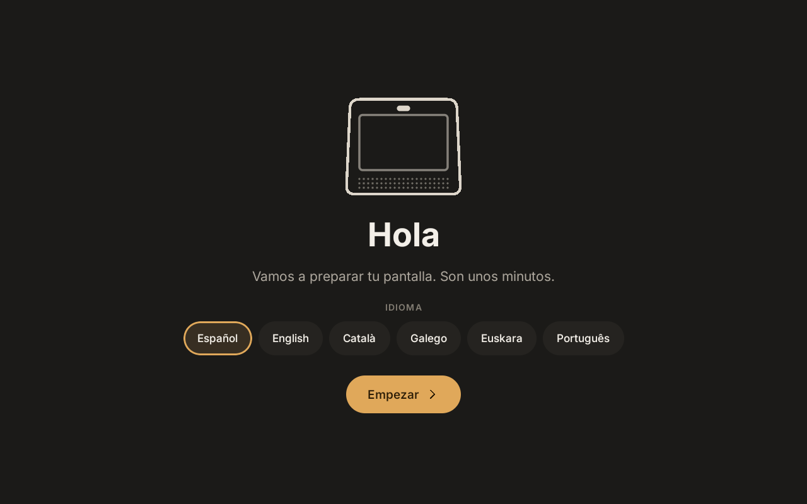

**Región y hora.** Zona horaria, hora automática y formato de 24 horas.

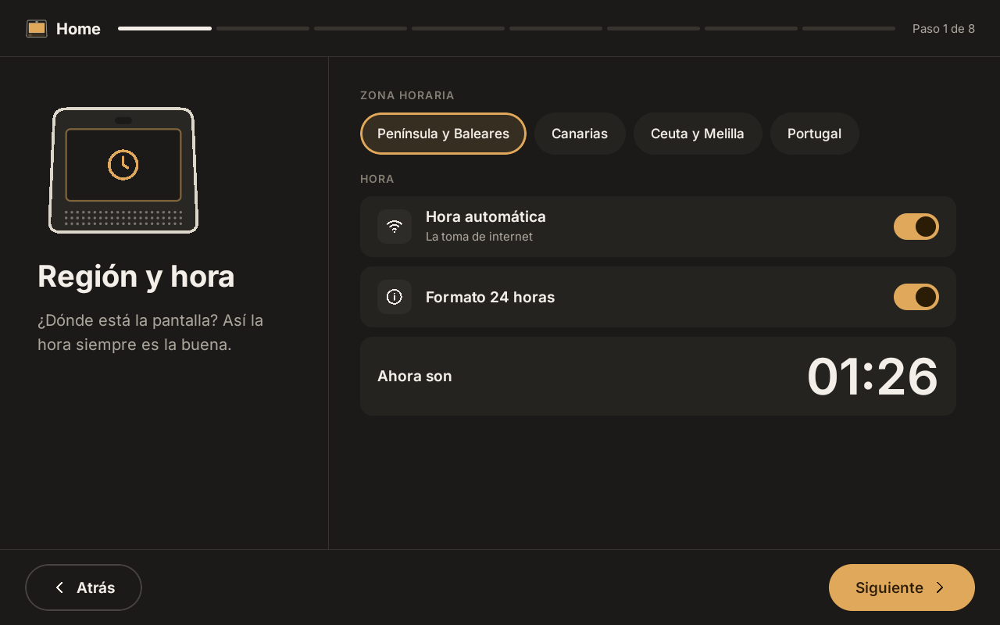

**Wi-Fi.** Salen las redes cercanas con su cobertura; las protegidas llevan un candado. Elige la tuya, escribe la contraseña y pulsa **Conectar**. Puedes saltarte este paso y conectarte luego desde Ajustes, pero sin conexión no se puede instalar Fully Kiosk ni poner la hora en automático.

**Nombre.** Cómo se verá el aparato en tu red y por Bluetooth.

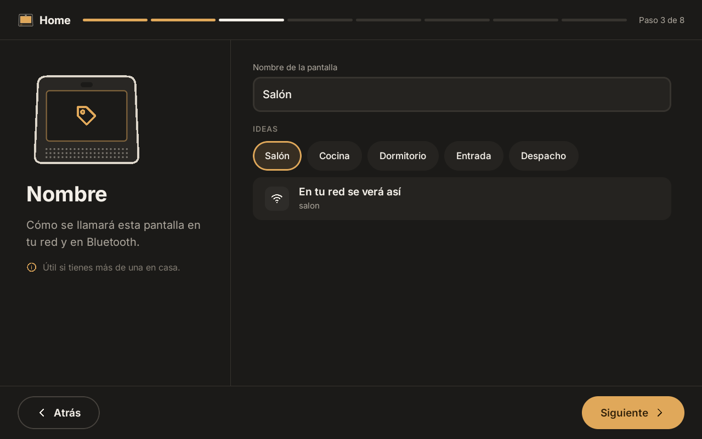

**Qué quieres instalar.** Solo se instala lo que marques.

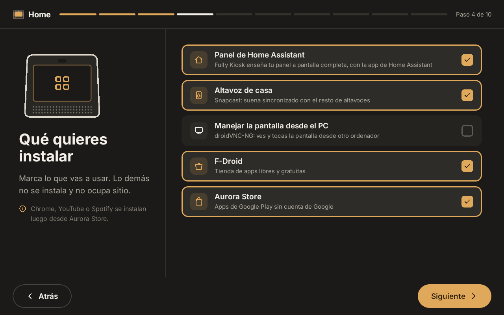

| Opción | Qué hace |
| --- | --- |
| Panel de Home Assistant | Descarga Fully Kiosk de su web oficial y lo deja como pantalla de inicio con tu panel |
| Altavoz de casa | Instala Snapcast para que suene a la vez que el resto de altavoces de la casa |
| Manejar la pantalla desde el PC | Instala droidVNC-NG; la contraseña se pone en la propia aplicación |
| F-Droid | Tienda de aplicaciones libres (marcada de serie) |
| Aurora Store | Apps de Google Play sin cuenta de Google (marcada de serie) |

Los pasos de **Home Assistant** y **Altavoz de casa** solo salen si los has marcado. El asistente busca el servidor en tu red; si no lo encuentra, puedes escribir la dirección tú (por ejemplo, `homeassistant.local:8123`).

<table>
  <tr>
    <td>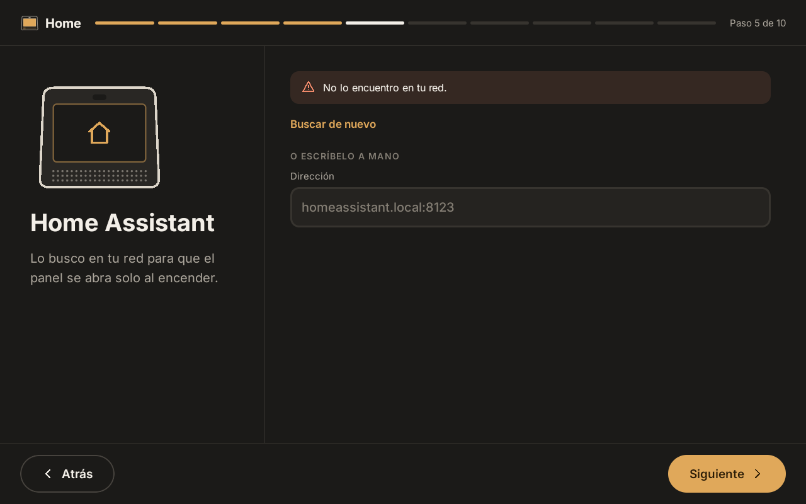</td>
    <td>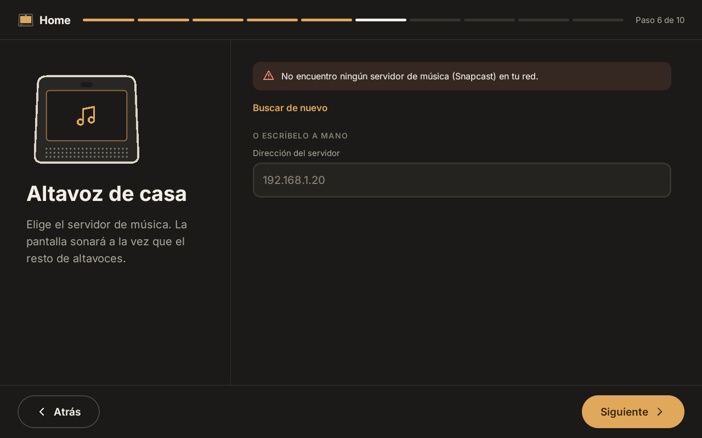</td>
  </tr>
</table>

**Pantalla.** Brillo (se ve el cambio en directo) y tiempo hasta que se apaga. Para un panel o un reloj, elige **Nunca**.

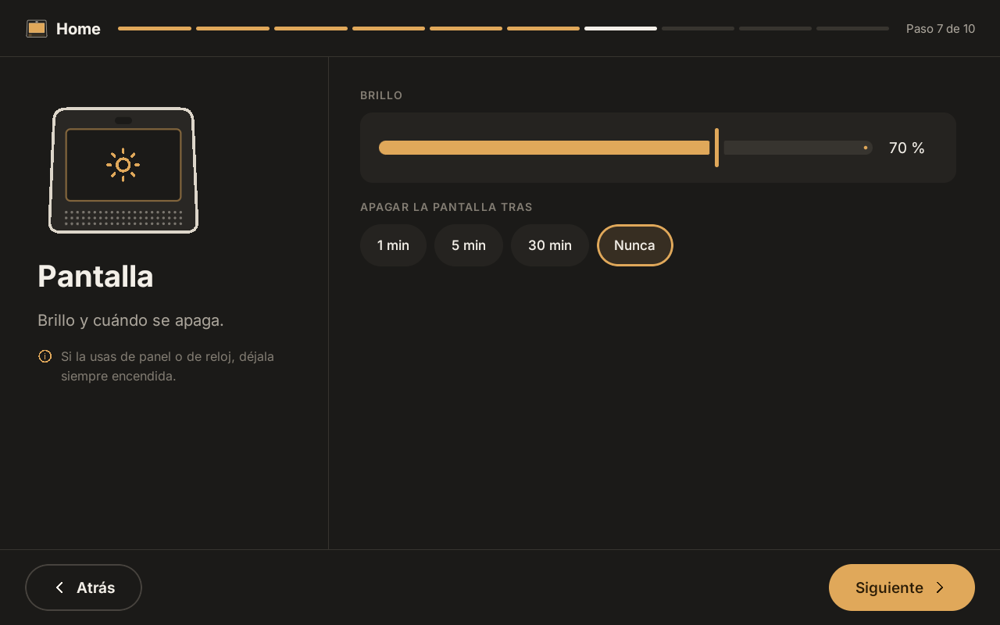

**Privacidad.** Activa o desactiva el micrófono y la cámara.

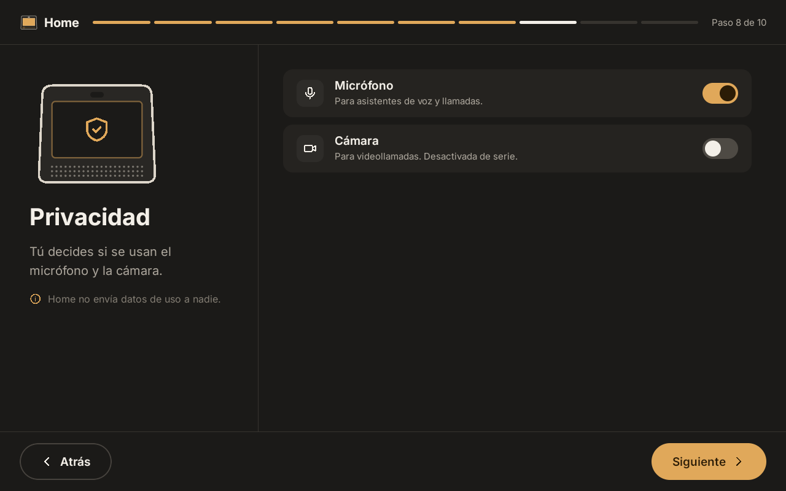

**Opciones avanzadas.** IP fija, dirección MAC, certificados propios y depuración ADB. Si no las necesitas, pulsa **Seguir**.

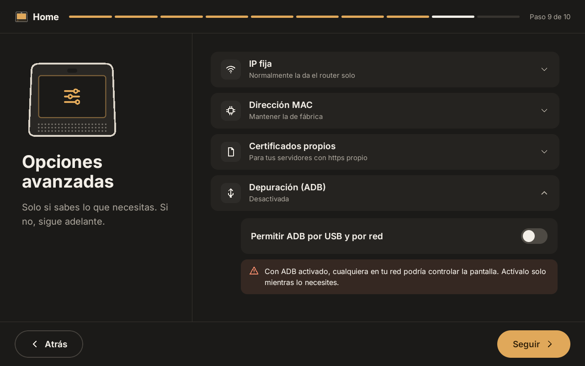

> [!WARNING]
> Con la depuración ADB activada, cualquier equipo de tu red puede controlar el aparato. Actívala solo cuando la necesites.

**Resumen.** Repasa la configuración; toca cualquier línea para cambiarla. Pulsa **Aplicar** para terminar.

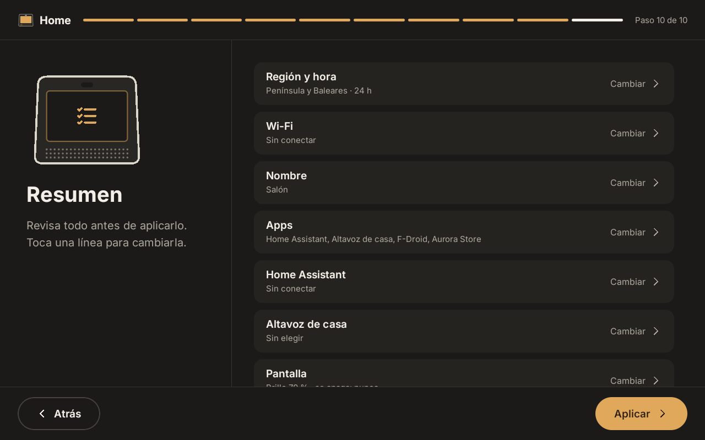

El asistente enseña el resultado de cada cosa que hace. Si cambiaste la MAC o añadiste certificados, se reinicia una vez para aplicarlos.

## 9. Actualizaciones, ADB y root

**Actualizaciones.** Las instala la app **Actualizaciones**, que también se abre desde **Ajustes → Sistema → Actualizaciones del sistema**. Busca versiones nuevas en las releases de este repositorio, te enseña qué traen y la descarga cuando tú quieras. Antes de instalarla comprueba la firma, que sea más nueva que la tuya y el tamaño. El aparato reinicia en el recovery, la instala y vuelve a Home con tus apps, ajustes y datos. Solo acepta actualizaciones firmadas por mí.

**ADB.** Viene desactivado. Se activa de dos formas:

- En el asistente, en **Opciones avanzadas → Depuración (ADB)**. Queda activado por USB y por Wi-Fi.
- Después, desde Ajustes: en **Información del dispositivo**, pulsa siete veces en **Número de compilación** para que aparezcan las **Opciones para desarrolladores** (en **Ajustes → Sistema**). Ahí activa **Depuración por USB**.

La primera vez que te conectes, el aparato te pedirá en pantalla que autorices el PC.

Por Wi-Fi se usa la **Depuración inalámbrica** de Android, en las mismas opciones para desarrolladores. Entra en ella, pulsa **Vincular dispositivo con código de vinculación** y escribe en el PC la dirección, el puerto y el código que salen en pantalla:

```powershell
.\platform-tools\adb.exe pair <IP>:<puerto de vinculación> <código>
.\platform-tools\adb.exe connect <IP>:<puerto>
```

> [!WARNING]
> Con ADB activado, quien tenga acceso a tu red puede intentar controlar el aparato. Apágalo cuando termines.

**Root.** Magisk va en el boot, pero el root viene apagado. Se activa en el asistente, en **Opciones avanzadas → Root (Magisk)**: se instala la app de Magisk y, cada vez que una app pida root, Magisk te pregunta antes de dárselo.

**Recovery.** Home lleva TWRP con su propio diseño. Es el que instala las actualizaciones, y desde él puedes ir a fastboot con **Reiniciar → Bootloader**.

<table>
  <tr>
    <td>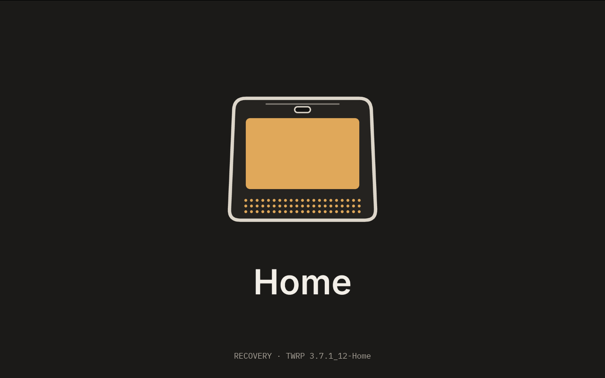</td>
    <td>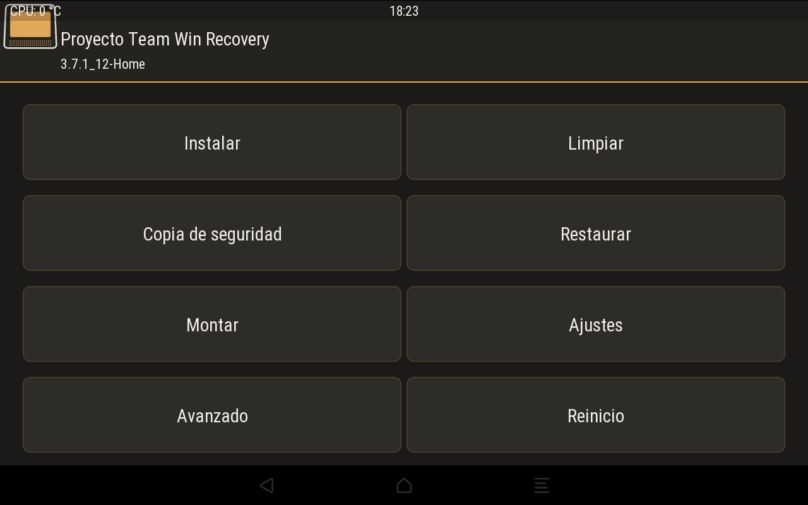</td>
  </tr>
</table>

## 10. Si algo va mal

| Qué pasa | Qué hacer |
| --- | --- |
| `fastboot devices` no muestra nada | Revisa el driver ([paso 3](#3-instalar-los-drivers-usb)) y el cable. En el Administrador de dispositivos no tiene que quedar ningún triángulo amarillo |
| En el Administrador de dispositivos no aparece nada al conectarlo | Prueba otro puerto USB del PC. En el Rev5, revisa el orden de los pines del adaptador |
| «No parece el Askey RG3205W desbloqueado» | El bootloader está bloqueado: [paso 5](#5-desbloquear-el-bootloader) |
| «SHA256 no coincide» | La descarga se ha dañado. Vuelve a descargar el zip |
| Windows no deja ejecutar el script | Ejecuta `Unblock-File .\instalar_home.ps1` y lánzalo con `powershell -ExecutionPolicy Bypass -File` |
| Se queda en modo carga al arrancar | Desconecta el USB del PC y vuelve a enchufar el aparato a la corriente |
| Los botones no sacan el menú | Repite el [paso 4](#4-entrar-en-modo-fastboot) con calma: suelta los tres botones justo cuando desaparezca el logo azul, y luego Encendido + Vol + una vez. Con la tapa quitada se pulsan mejor |
| No sé dónde está el J4902 o cómo va el cable | Mira las fotos del [paso 2](#el-cable-para-el-rev5) |
| La animación de arranque dura más de 15 minutos | Vuelve a fastboot y repite el [paso 6](#6-instalar-home) |
| No sale ninguna red Wi-Fi | Pulsa **Buscar de nuevo**. Si sigue igual, reinicia el aparato |
| No arranca ni entra en fastboot | Rescate por EDL: [sección 11](#11-copia-de-seguridad-y-rescate-por-edl) |

Si no lo consigues, abre una incidencia en [Issues](../../../issues) contando tu revisión (Rev4 o Rev5), el paso en el que estabas y el mensaje que sale. Y si todo ha ido bien, me ayuda mucho que lo cuentes en un [informe de prueba](../../../issues/new?template=informe_prueba.yml): son dos minutos.

## 11. Copia de seguridad y rescate por EDL

EDL (*Emergency Download Mode*) es el modo de emergencia de Qualcomm. Funciona aunque el sistema o el bootloader estén dañados y permite leer y escribir cualquier partición. Es para usuarios con algo de experiencia, pero vale la pena hacer una copia completa antes de instalar.

**Entrar en EDL** (según [zry98](https://github.com/zry98/movistar-home-hacks/tree/main/RG3205W)):

- **Rev5:** une `D+` y `GND` del conector J4902 mientras conectas la corriente y mantenlo 3 segundos.
- **Rev4:** mira la guía de zry98.

**Herramientas:**

- [`edl`](https://github.com/bkerler/edl) de B. Kerler (Windows, Linux y macOS). En Windows necesita el driver WinUSB, que se pone con [Zadig](https://zadig.akeo.ie/) sobre el dispositivo `05C6:9008`.
- El programador *firehose* que publica zry98: [`RG3205W/firehose.mbn`](https://github.com/zry98/movistar-home-hacks/tree/main/RG3205W), SHA256 `0e03a8189b7451d1bb81d6fb10efbcefd399623edcb015af45008eedf8fd1298`.

**Copia completa** (solo lee, no escribe nada):

```bash
edl --loader=firehose.mbn printgpt
edl --loader=firehose.mbn rl copia_rg3205w --genxml
```

Guarda la carpeta que sale en un sitio seguro. Incluye `persist` y otras particiones con datos únicos de tu aparato (direcciones MAC y calibraciones) que no se pueden sacar de otra unidad.

> [!CAUTION]
> No escribas particiones por EDL sin una copia completa de tu propio aparato. Restaurar datos de otra unidad puede dejar sin funcionar el Wi-Fi, el Bluetooth o las calibraciones.
