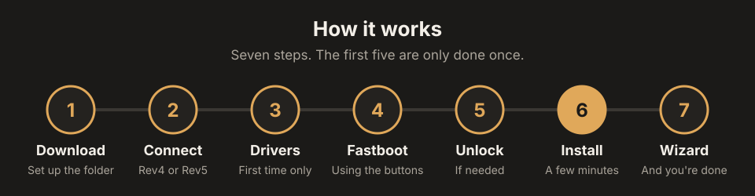
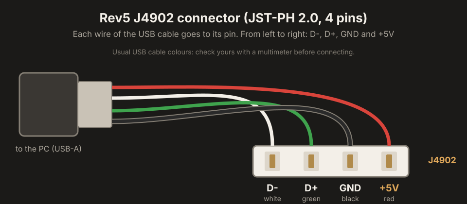
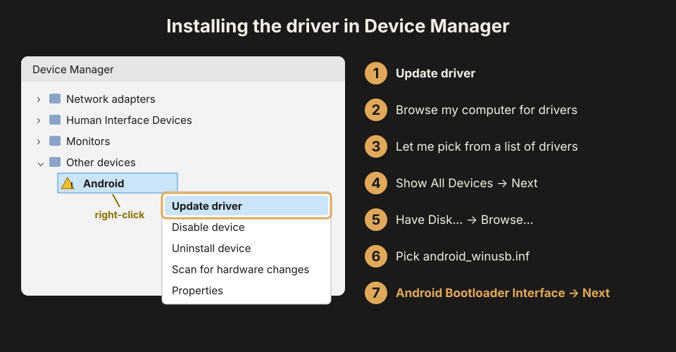
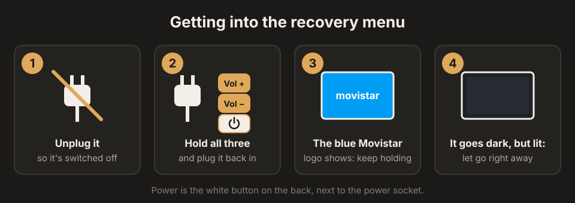
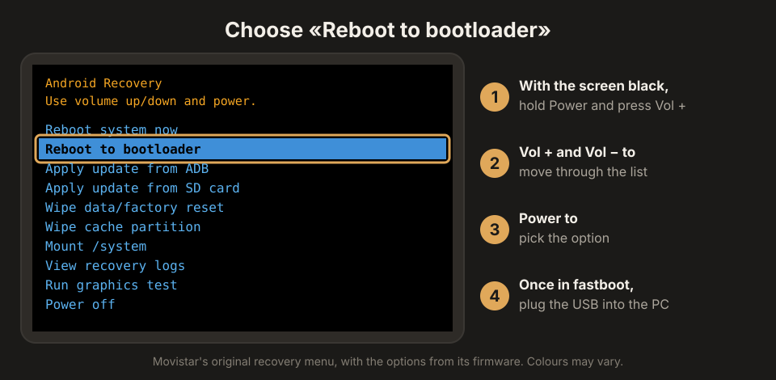

<p align="right"><a href="INSTALAR.md">Español</a> · <a href="../README.en.md">Back to the main page</a></p>

# Installation guide

This guide explains how to install Home on an Askey RG3205W from a Windows PC. It's meant to be followed from start to finish even if you've never installed a ROM: each step says what to do, what you'll see and what to do if it doesn't work. Allow 30 to 45 minutes the first time.

> [!NOTE]
> Home hasn't been released yet. Steps 1 to 5 (opening it, connecting it, drivers and unlocking) don't depend on the version, so you can get them done now.

> [!WARNING]
> Installing it **wipes all data** on the device. Opening it and changing its software may void your warranty and isn't covered by your carrier contract. Follow this guide at your own risk.

<p align="center">
  
</p>

## Contents

1. [What you need](#1-what-you-need)
2. [Rev4 or Rev5, and connecting it to the PC](#2-rev4-or-rev5-and-connecting-it-to-the-pc)
3. [Installing the USB drivers](#3-installing-the-usb-drivers)
4. [Getting into fastboot mode](#4-getting-into-fastboot-mode)
5. [Unlocking the bootloader](#5-unlocking-the-bootloader)
6. [Installing Home](#6-installing-home)
7. [First boot](#7-first-boot)
8. [Setup wizard](#8-setup-wizard)
9. [Updates, ADB and root](#9-updates-adb-and-root)
10. [If something goes wrong](#10-if-something-goes-wrong)
11. [Backup and rescue over EDL](#11-backup-and-rescue-over-edl)

---

## 1. What you need

| | Where to get it |
| --- | --- |
| Askey RG3205W, Rev4 or Rev5 | — |
| PC running 64-bit Windows 10 or 11 | — |
| A USB cable that suits your revision | [Step 2](#2-rev4-or-rev5-and-connecting-it-to-the-pc) |
| Home | This repository's [Releases](../../../releases/latest), file `Home-<version>-RG3205W.zip` |
| SDK Platform-Tools (`adb` and `fastboot`) | [developer.android.com/tools/releases/platform-tools](https://developer.android.com/tools/releases/platform-tools) |
| Google USB Driver | [developer.android.com/studio/run/win-usb](https://developer.android.com/studio/run/win-usb) |

Create a working folder, for example `C:\Home`, and extract both the Home zip and the Platform-Tools zip into it. It should look like this:

```
C:\Home\
├── boot.img        + boot.img.sha256
├── recovery.img    + recovery.img.sha256
├── system.img      + system.img.sha256
├── vendor.img      + vendor.img.sha256
├── splash.img      + splash.img.sha256
├── instalar_home.ps1
├── LEEME.txt
└── platform-tools\
    ├── adb.exe
    └── fastboot.exe
```

Every command in this guide is typed into PowerShell from that folder. To open it there: go to `C:\Home` in File Explorer, click the address bar, type `powershell` and press Enter.

> [!TIP]
> If you're up for it, make a full backup of the device over EDL before installing ([section 11](#11-backup-and-rescue-over-edl)). With it you can always put the device back the way it was.

## 2. Rev4 or Rev5, and connecting it to the PC

There are two board revisions and each one connects to the PC differently. The date on the label won't tell you which one you have: you need to take the back cover off.

**How to open it:**

1. Release the 10 plastic clips around the edges of the back cover.
2. Remove the 8 screws under the cover.
3. Remove the 4 screws hidden under the black rubber strip along the bottom.

With the cover off, look at the corner of the board marked in red in the photos, and at the print at the bottom right, which says **Rev4** or **Rev5**:

<table>
  <tr>
    <td width="50%"></td>
    <td width="50%"></td>
  </tr>
  <tr>
    <td align="center"><b>Rev4</b>: has a USB-C port soldered on (top right)</td>
    <td align="center"><b>Rev5</b>: that spot is empty</td>
  </tr>
</table>
<p align="center"><sub>Photos from <a href="https://github.com/zry98/movistar-home-hacks/tree/main/RG3205W">zry98/movistar-home-hacks</a> (GPL-3.0)</sub></p>

| Revision | How to recognise it | Connection to the PC |
| --- | --- | --- |
| **Rev4** | Has a USB-C port soldered to the board | A regular USB-C cable, nothing else |
| **Rev5** | No USB-C port (the most common one) | Internal **J4902** connector: you need a cable like the one below |

### The cable for the Rev5

The **J4902** is the white 4-pin connector (JST-PH 2.0) near the empty USB-C spot. It carries the four USB lines, so all you need is to join it to a regular USB cable. These are its pins, from left to right:

<p align="center">
  
  <br>
  <sub>Photo from <a href="https://github.com/zry98/movistar-home-hacks/tree/main/RG3205W">zry98/movistar-home-hacks</a> (GPL-3.0)</sub>
</p>

<p align="center">
  
</p>

How to make it:

1. Take a USB cable you don't need and cut it, keeping the end with the USB-A plug (the one that goes into the PC).
2. Strip the four wires inside. They're usually red, white, green and black.
3. Join each wire to its pin using a **4-pin male JST-PH 2.0 connector** or, if you don't have one, four 2.0 mm pitch female terminals:

   | J4902 pin | USB cable wire |
   | --- | --- |
   | D- (leftmost) | White |
   | D+ | Green |
   | GND | Black |
   | +5V (rightmost) | Red |

4. Before plugging it into the board, check with a multimeter that each pin reaches the right contact on the USB plug.
5. Plug it into the J4902 with the same orientation as in the photo.

> [!CAUTION]
> These are the standard USB colours, but not every cable follows them. Always check with the multimeter: swapping +5V and GND can damage the board.

All this hardware information comes from the work at [zry98/movistar-home-hacks](https://github.com/zry98/movistar-home-hacks/tree/main/RG3205W).

## 3. Installing the USB drivers

Windows needs the **Google USB Driver** to talk to the device in fastboot mode. You only do this once.

<p align="center">
  
</p>

1. Extract the Google USB Driver. You'll get a `usb_driver` folder containing `android_winusb.inf`.
2. Put the device in fastboot mode ([step 4](#4-getting-into-fastboot-mode)) and connect it to the PC.
3. Open **Device Manager**: Windows key + X → Device Manager.
4. Under **Other devices** you'll see one with a yellow triangle, usually called "Android".
5. Right-click it → **Update driver** → **Browse my computer for drivers** → **Let me pick from a list of available drivers on my computer**.
6. If it asks for the device type, choose **Show All Devices** and click **Next**.
7. Click **Have Disk…** → **Browse…** and pick `android_winusb.inf`.
8. Select **Android Bootloader Interface**, click **Next** and accept the Windows warning if it shows up.
9. Check that the PC can see it:

   ```powershell
   .\platform-tools\fastboot.exe devices
   ```

   You should see a serial number followed by `fastboot`. If nothing shows up, see [section 10](#10-if-something-goes-wrong).

> [!TIP]
> USB ADB with Android running uses the same driver: repeat the process and choose **Android Composite ADB Interface**.

| Mode | VID:PID | Driver |
| --- | --- | --- |
| Fastboot | `18D1:D00D` | Android Bootloader Interface |
| ADB | `18D1:4EE7` | Android Composite ADB Interface |
| EDL | `05C6:9008` | WinUSB via Zadig ([section 11](#11-backup-and-rescue-over-edl)) |

## 4. Getting into fastboot mode

Fastboot mode is what lets you install the system. With Movistar's software you get there from its recovery menu, which **doesn't show up on its own**: you need two button combinations in a row.

> [!IMPORTANT]
> Connect the USB cable to the PC **after** getting into fastboot. If the device boots with the PC's USB connected, it may get stuck in charging mode.

**First combination: getting into recovery**

<p align="center">
  
</p>

1. Unplug the device so it's switched off.
2. Hold down **Vol +** and **Vol −** (on top) and **Power** (the white button on the back, next to the power socket), and keep holding them while you plug it back in.
3. The blue screen with the white Movistar logo shows up. **Don't let go yet.**
4. When the logo disappears and the screen goes dark (but still slightly lit), **let go of all three buttons right away**.

**Second combination: opening the menu and choosing fastboot**

<p align="center">
  
</p>

5. With the screen dark, hold **Power** and press **Vol +** once: the menu shows up.
6. Use **Vol +** and **Vol −** to move to **Reboot to bootloader** and select it with **Power**.
7. Once it's in fastboot, connect the USB cable to the PC.

> [!TIP]
> If the menu doesn't show up, start again from point 1: the usual cause is letting go of the buttons too early or too late. If you can't press them properly with the case on, you can press them directly with the back cover off.

**If you already have Home installed** (for example, to reinstall), it's easier: from Home's recovery (TWRP), **Reboot → Bootloader** gets you into fastboot. With ADB enabled this works too:

```powershell
.\platform-tools\adb.exe reboot bootloader
```

## 5. Unlocking the bootloader

Check the bootloader state:

```powershell
.\platform-tools\fastboot.exe getvar unlocked
```

If it says `unlocked: yes`, go straight to [step 6](#6-installing-home). If it says `no`, unlock it:

```powershell
.\platform-tools\fastboot.exe flashing unlock
.\platform-tools\fastboot.exe oem unlock
```

If the device asks for confirmation on screen, accept it with the volume and power buttons. Then check again with `getvar unlocked`.

> [!CAUTION]
> Don't lock the bootloader again (`fastboot flashing lock` or `oem lock`) with Home installed: the device might stop booting.

## 6. Installing Home

The package comes with an installer that does everything for you and checks every image before writing it.

Windows blocks scripts downloaded from the internet. The first time, unblock it:

```powershell
Unblock-File .\instalar_home.ps1
```

Do a **dry run** first. It doesn't write anything: it checks the images are fine and shows you what it's going to do.

```powershell
powershell -ExecutionPolicy Bypass -File .\instalar_home.ps1 -Accion Instalar
```

If every image shows up as `ok`, run the real installation:

```powershell
powershell -ExecutionPolicy Bypass -File .\instalar_home.ps1 -Accion Instalar -DeVerdad
```

The installer checks it's an RG3205W with an unlocked bootloader and asks you to confirm: type `SI` and press Enter. It takes a few minutes.

```
== Fastboot
  > fastboot flash boot ...       OKAY
  > fastboot flash recovery ...   OKAY
  > fastboot flash vendor ...     OKAY
  > fastboot flash system ...     OKAY
  > fastboot flash splash ...     OKAY
  > fastboot format cache         OKAY
  > fastboot format userdata      OKAY
== Hecho
```

> [!NOTE]
> The message `Invalid sparse file format at header magic` is normal: fastboot splits `system.img` into chunks to send it.

The installer only writes to `boot`, `recovery`, `vendor`, `system` and `splash`, and formats `cache` and `userdata`. It doesn't touch the partitions holding your device's own data (`persist`, `modem`, calibration). The recovery is always installed because it's what applies updates.

## 7. First boot

1. Disconnect the USB cable from the PC.
2. Unplug the device and plug it back in.

The Home splash screen shows up, then the boot animation. The first time takes several minutes, because Android sets up the apps and encrypts the data; meanwhile the animation keeps looping. That's normal.

<table>
  <tr>
    <td></td>
    <td></td>
  </tr>
  <tr>
    <td align="center"><sub>Splash screen</sub></td>
    <td align="center"><sub>Boot animation</sub></td>
  </tr>
</table>

## 8. Setup wizard

Once it finishes booting, the setup wizard opens. Every step has **Back** at the bottom left and **Next** at the bottom right. The screenshots are in Spanish; the wizard also comes in English, Catalan, Galician, Basque and Portuguese.

> [!TIP]
> You can try the wizard in your browser before installing anything: [open the demo](https://daniel1286.github.io/home-rom-rg3205w/).

**Welcome.** Pick the language: the wizard switches right away and the system is set to that language.


**Region and time.** Time zone, automatic time and 24-hour format.


**Wi-Fi.** Nearby networks show up with their signal; secured ones have a padlock. Pick yours, type the password and tap **Connect**. You can skip this step and connect later from Settings, but without a connection Fully Kiosk can't be installed and the time can't be set automatically.

**Name.** How the device will show up on your network and over Bluetooth.


**What to install.** Only what you tick gets installed.


| Option | What it does |
| --- | --- |
| Home Assistant panel | Downloads Fully Kiosk from its official website and sets it as the home screen with your dashboard |
| Home speaker | Installs Snapcast so it plays in sync with the rest of your speakers |
| Control the screen from your PC | Installs droidVNC-NG; the password is set in the app itself |
| F-Droid | Free software app store (ticked by default) |
| Aurora Store | Google Play apps without a Google account (ticked by default) |

The **Home Assistant** and **Home speaker** steps only show up if you ticked them. The wizard looks for the server on your network; if it can't find it, you can type the address yourself (for example, `homeassistant.local:8123`).

<table>
  <tr>
    <td></td>
    <td></td>
  </tr>
</table>

**Display.** Brightness (you see the change live) and screen timeout. For a dashboard or a clock, choose **Never**.


**Privacy.** Turn the microphone and camera on or off.


**Advanced options.** Static IP, MAC address, your own certificates and ADB debugging. If you don't need them, tap **Continue**.


> [!WARNING]
> With ADB debugging on, any computer on your network can control the device. Only turn it on when you need it.

**Summary.** Go over the settings; tap any line to change it. Tap **Apply** to finish.


The wizard shows the result of everything it does. If you changed the MAC or added certificates, it reboots once to apply them.

## 9. Updates, ADB and root

**Updates.** They're installed by the **Updates** app, which also opens from **Settings → System → System updates**. It looks for new versions in this repository's releases, shows you what's new and downloads it when you want. Before installing it checks the signature, that it's newer than yours and the size. The device reboots into the recovery, installs it and comes back to Home with your apps, settings and data. It only accepts updates signed by me.

**ADB.** It's off by default. There are two ways to turn it on:

- In the setup wizard, under **Advanced options → Debugging (ADB)**. It's turned on over USB and Wi-Fi.
- Afterwards, from Settings: in **About device**, tap **Build number** seven times so that **Developer options** show up (under **Settings → System**). Turn on **USB debugging** there.

The first time you connect, the device asks you on screen to authorize the PC.

Over Wi-Fi it uses Android's **Wireless debugging**, in the same developer options. Open it, tap **Pair device with pairing code** and type the address, port and code shown on screen on the PC:

```powershell
.\platform-tools\adb.exe pair <IP>:<pairing port> <code>
.\platform-tools\adb.exe connect <IP>:<port>
```

> [!WARNING]
> With ADB on, anyone with access to your network can try to control the device. Turn it off when you're done.

**Root.** Magisk is in the boot image, but root is off by default. You turn it on in the setup wizard, under **Advanced options → Root (Magisk)**: the Magisk app gets installed and, every time an app asks for root, Magisk asks you before granting it.

**Recovery.** Home comes with TWRP in its own design. It's what installs updates, and from it you can go to fastboot with **Reboot → Bootloader**.

<table>
  <tr>
    <td></td>
    <td></td>
  </tr>
</table>

## 10. If something goes wrong

| What happens | What to do |
| --- | --- |
| `fastboot devices` shows nothing | Check the driver ([step 3](#3-installing-the-usb-drivers)) and the cable. Device Manager shouldn't show any yellow triangle |
| Nothing shows up in Device Manager when you connect it | Try another USB port on the PC. On a Rev5, check the pin order of the adapter |
| "No parece el Askey RG3205W desbloqueado" | The bootloader is locked: [step 5](#5-unlocking-the-bootloader) |
| "SHA256 no coincide" | The download is corrupted. Download the zip again |
| Windows won't run the script | Run `Unblock-File .\instalar_home.ps1` and launch it with `powershell -ExecutionPolicy Bypass -File` |
| It gets stuck in charging mode at boot | Disconnect the PC's USB and plug the device back into the power |
| The buttons don't bring up the menu | Repeat [step 4](#4-getting-into-fastboot-mode) calmly: let go of all three buttons right when the blue logo disappears, then Power + Vol + once. With the cover off the buttons are easier to press |
| I can't find the J4902 or don't know how the cable goes | See the photos in [step 2](#the-cable-for-the-rev5) |
| The boot animation lasts more than 15 minutes | Go back to fastboot and repeat [step 6](#6-installing-home) |
| No Wi-Fi networks show up | Tap **Search again**. If it's still the same, reboot the device |
| It won't boot or get into fastboot | Rescue over EDL: [section 11](#11-backup-and-rescue-over-edl) |

If you still can't get it working, open an issue in [Issues](../../../issues) with your revision (Rev4 or Rev5), the step you were on and the message you see. And if everything went well, it helps me a lot if you say so in a [test report](../../../issues/new?template=informe_prueba.yml): it takes two minutes.

## 11. Backup and rescue over EDL

EDL (*Emergency Download Mode*) is Qualcomm's emergency mode. It works even if the system or the bootloader are broken, and it can read and write any partition. It's for users with some experience, but a full backup before installing is well worth it.

**Getting into EDL** (as documented by [zry98](https://github.com/zry98/movistar-home-hacks/tree/main/RG3205W)):

- **Rev5:** short `D+` and `GND` on the J4902 connector while you plug in the power, and hold it for 3 seconds.
- **Rev4:** see zry98's guide.

**Tools:**

- [`edl`](https://github.com/bkerler/edl) by B. Kerler (Windows, Linux and macOS). On Windows it needs the WinUSB driver, installed with [Zadig](https://zadig.akeo.ie/) on the `05C6:9008` device.
- The *firehose* programmer published by zry98: [`RG3205W/firehose.mbn`](https://github.com/zry98/movistar-home-hacks/tree/main/RG3205W), SHA256 `0e03a8189b7451d1bb81d6fb10efbcefd399623edcb015af45008eedf8fd1298`.

**Full backup** (read-only, writes nothing):

```bash
edl --loader=firehose.mbn printgpt
edl --loader=firehose.mbn rl copia_rg3205w --genxml
```

Keep the resulting folder somewhere safe. It includes `persist` and other partitions with data unique to your device (MAC addresses and calibration) that can't be taken from another unit.

> [!CAUTION]
> Don't write partitions over EDL without a full backup of your own device. Restoring data from another unit can break Wi-Fi, Bluetooth or calibration.
